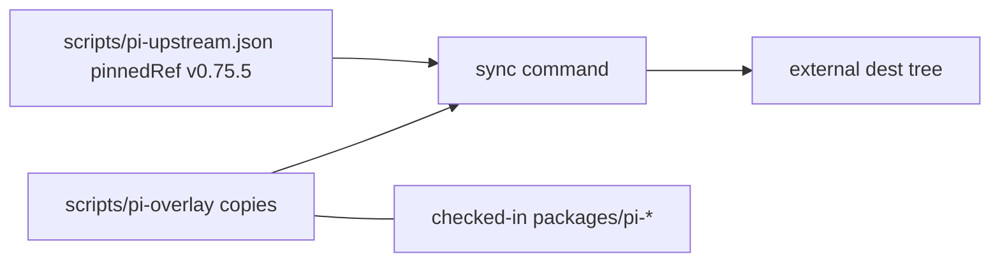

# Pi Engine Host - Plan

## Goal Capsule

**Objective:** A maintainer can regenerate the pinned `v0.75.5` engine onto a destination outside the repo and reapply the stored overlay without hand-merging those files. The checked-in engine still starts, still uses `~/.gsd`, and still runs the existing project workflow.

**Means:** Generate that external tree from the pinned git tag and reapply a stored overlay that lives outside the generated tree (KTD1, KTD2).

**Authority:** This plan, then `docs/dev/ADR-010-pi-clean-seam-architecture.md` and `docs/dev/pi-upstream.md` where they do not conflict with KTD2.

**Stop conditions:** Stop if a unit would change a checked-in file under `packages/pi-*/src` or `packages/pi-*/test`, move `pinnedRef` off `v0.75.5`, or make `@gsd/pi-*` resolve to a published `@earendil-works/pi-*` tarball.

**Execution profile:** Substrate first. The running engine stays the current tree until a later plan.

**Finishes and ships:** The implementer lands each unit on its own commit, opens one pull request for this plan, and does not regenerate `packages/pi-*` on the PR branch.

## Product Contract

### Summary

GSD keeps its workflow, host packages, and `@gsd/pi-*` import names. The Pi engine stops being a hand-edited copy of upstream. This plan makes regeneration safe and reviewable. It does not switch the process to Pi 1.6.1.

### Problem Frame

The repo vendors four Pi packages at `v0.75.5` while upstream is `v1.6.1`. Almost all recent commits are GSD workflow work, but every upstream fix still requires a wipe-and-merge of those packages. The vendor scripts do not preserve GSD package identity, do not restore the seam, and can copy whatever happens to be in the local cache. Maintainers have been avoiding that path, so the engine drifts.

### Key Decisions

- KD1. Track upstream Pi instead of keeping a hand-merged engine. (session-settled: user-approved — chosen over continued vendor merges, a greenfield port, and a second GSD Lite product: the workflow and its tests stay; the engine becomes something maintainers can update.) Governs R1, R2.
  Conflict: a direct npm alias of `@earendil-works/pi-*` cannot satisfy R3 or the seam. Published packages export `.` plus one extra path, not `./*`. This repo has hundreds of `@gsd/pi-coding-agent/<subpath>` imports, and the seam deletes upstream `modes/`, `cli/`, and `agent-session`. KTD2 is the mechanism that still honors KD1.

### Requirements

#### Engine updates

- R1. A maintainer can regenerate the Pi engine from the pinned tag without hand-merging thousands of upstream files.
- R2. Regeneration onto an external destination restores GSD package identity, including `piConfig.configDir` `.gsd` and the `@gsd/pi-*` names, and restores the overlay files. Seam deletes and import rewrites stay on `scripts/apply-seam.cjs` until a follow-on plan runs that step against a fixture.

#### Compatibility

- R3. Existing `@gsd/pi-*` import specifiers keep resolving, including deep paths the extension host loads today, such as `theme/theme.js`.
- R4. Claude tool-schema behavior covered by `pnpm run test:pi-claude-schemas` still passes. This plan does not change those sources, so the check is a regression guard on any accidental edit.

#### Safety of this plan

- R5. This plan does not move `scripts/pi-upstream.json` `pinnedRef` off `v0.75.5` and does not replace workspace `@gsd/pi-*` with published npm packages.

### Scope Boundaries

In scope: vendor-script safety, an overlay store outside `packages/pi-*`, a sync command that is tested on a temporary tree, fast-gate coverage, and a triage of every allowlisted path.

Deferred for a follow-on plan: leaf facades over published `@earendil-works/pi-ai`, `@earendil-works/pi-tui`, and `@earendil-works/pi-agent-core`, and the pin move from `v0.75.5` to `v1.6.1`.

Outside this product's identity: a new repository, a reduced "GSD Lite" product, and deleting `src/resources/extensions/gsd`.

### Success Criteria

- The in-process sync merge, exercised on a temporary destination, keeps `.gsd` and writes the overlay file. A real in-repo regeneration stays refused.
- `scripts/ci-fast-gates.sh` fails when an allowlisted overlay snapshot disagrees with the checked-in engine file. With `VERIFY_PI_PATCHES_BRANCH=1`, it also fails when a committed `packages/pi-*` source edit is not allowlisted.
- The triage lists every `patchAllowlist` path with one disposition.
- `git diff` for this plan does not change files under `packages/pi-*/src` or `packages/pi-*/test`.

### Assumptions

- The git tag remains the generation source. Published npm tarballs are not used as the runtime in this plan, because their export map and the seam deletes make them the wrong artifact.
- The overlay store is committed file copies, not a patch series. A patch series fails when context lines drift, and the allowlist is already a file list.
- Adding `verify:pi-patches` and the snapshot check to fast gates is acceptable. Both are git and file comparisons, not test suites.
- `packages/pi-coding-agent` stays a workspace package after this plan. Only a follow-on plan may turn a leaf package into a facade, and only after triage marks that package free of interior patches.

## Planning Contract

### Key Technical Decisions

- KTD1. Upstream bulk is generated from the pinned git tag into `packages/pi-*`. People do not hand-edit generated files. The files GSD must keep are copied from `scripts/pi-overlay/` after generation. Governs R1, R2.
- KTD2. Do not point `@gsd/pi-*` at `@earendil-works/pi-*` with an npm alias or `patchedDependencies`. The published 0.75.5 and 1.6.1 packages do not export `./*`, the seam removes modules the published package still contains, and `packages/pi-coding-agent` depends on `@gsd/agent-core` and `@gsd/native`. Governs R3, R5. This is why KD1's alias reading was rejected on evidence rather than by preference.
- KTD3. `scripts/vendor-pi.cjs` captures `name`, `version`, `description`, `gsd`, and `piConfig` with `captureGsdFields` before `rmSync`. `scripts/vendor-pi-deps.cjs` must do the same. Its old `preserveGsdPackageJson` read the destination after the copy, so `piConfig` became upstream's `.pi`. `scripts/vendor-pi-coding-agent-core.cjs` does not rewrite `package.json`. It only gains the pin check. All three refuse to copy when the cache `HEAD` is not the requested ref. They do not `git pull` the cache's current branch over a tag checkout. Governs R2, R5.
- KTD4. CI does not run generation. Generation is opt-in and tested on a temporary directory. A shallow cache that was last fetched at `v1.6.1` must not be treated as `v0.75.5`. Governs R5.

### High-Level Technical Design

`sync` writes only the external destination. CI compares `scripts/pi-overlay/` to the checked-in `packages/pi-*` tree and does not run `sync`.

### Sequencing

U1 before U2. U2 before U3. U4 after U2, and it does not wait on U3. U5 after U2. U6 after U1 and U3.

## Implementation Units

### U1. Preserve package identity and refuse a mismatched cache

**Goal:** Vendor entry points keep GSD `package.json` fields and refuse to copy a cache that is not the pinned tag.

**Requirements:** R2, R5

**Dependencies:** none

**Files:**
- Modify: `scripts/vendor-pi.cjs`
- Modify: `scripts/vendor-pi-deps.cjs`
- Modify: `scripts/vendor-pi-coding-agent-core.cjs`
- Test: `scripts/tests/vendor-pi-preserve.test.mjs`

**Approach:**
- Export pure helpers from `scripts/vendor-pi.cjs` and call `main` only when the file is the process entry.
- Capture `name`, `version`, `description`, `gsd`, and `piConfig` from the destination `package.json` before `rmSync`. After the copy, write those fields back over the upstream manifest and still delete `publishConfig`. An explicit GSD package name argument wins over both.
- Resolve the requested ref to a commit in the cache with `git rev-parse`. If the cache is missing or `HEAD` is a different commit, exit non-zero with a message that names both commits. Do not `git pull` the cache's current branch over a tag checkout.
- `vendor-pi-deps.cjs` captures the same five fields before `rmSync` and merges them after the copy. It does not keep a helper that reads the destination after the copy.
- `vendor-pi-coding-agent-core.cjs` only gains the pin check. It does not rewrite `package.json`.
- Do not run these scripts against the real `packages/pi-*` tree in tests.

**Patterns to follow:** `captureGsdFields` in `scripts/vendor-pi.cjs`. `scripts/pi-upstream.json` `pinnedRef`.

**Test scenarios:**
- Saved manifest `{ "name": "old", "piConfig": { "name": "gsd", "configDir": ".gsd" }, "gsd": { "linkable": true } }` merged onto an upstream manifest with `piConfig.configDir` `.pi` and `publishConfig` yields `configDir` `.gsd`, keeps `gsd.linkable`, and omits `publishConfig`.
- Passing GSD name `@gsd/pi-ai` sets `name` to that value even when the saved manifest had a different name.
- A temporary git repo whose `HEAD` is not the requested ref makes the cache check throw or return a non-zero result, and does not require network.
- A temporary git repo whose `HEAD` equals the requested ref passes the cache check.

**Verification:** `node --test scripts/tests/vendor-pi-preserve.test.mjs` passes. `git diff --name-only` does not list `packages/pi-*/src` or `packages/pi-*/test`.

### U2. Store the overlay outside the generated tree

**Goal:** Every corrected allowlist file and every protected seam file has a committed copy that a wipe cannot delete.

**Requirements:** R1, R2

**Dependencies:** U1

**Files:**
- Create: `scripts/pi-overlay/` mirroring the repo-relative paths in `patchAllowlist`
- Create: `scripts/check-pi-overlay-snapshot.cjs`
- Modify: `scripts/pi-upstream.json` to add `overlayDir` with value `scripts/pi-overlay`
- Test: `scripts/tests/pi-overlay-snapshot.test.mjs`

**Approach:**
- Before copying, edit `patchAllowlist`: drop `packages/pi-coding-agent/src/agent-core.d.ts` because that file is absent, and replace `packages/pi-coding-agent/src/core/bash-interceptor.ts` with `packages/pi-coding-agent/src/core/tools/bash-interceptor.ts`.
- The overlay set is the corrected `patchAllowlist` plus every `protectedPiCoreFiles` path in `scripts/pi-seam.json` that is not already listed. Those protected files are seam shims a core wipe would otherwise drop, and `apply-seam.cjs` does not recreate them.
- Copy each path in that set into `scripts/pi-overlay/<same relative path>`.
- The checker walks `patchAllowlist`, including glob entries such as `packages/pi-coding-agent/src/theme/**`. For every matched file, the bytes under `scripts/pi-overlay/` must equal the bytes in the repo. A missing snapshot or a byte mismatch exits non-zero and prints the path.
- Paths outside `patchAllowlist` are not copied.
- Do not modify the source files while copying.

**Patterns to follow:** `scripts/verify-pi-patches.cjs` pathspec and glob handling.

**Test scenarios:**
- A fixture allowlist of one file with identical bytes passes.
- The same fixture with one changed snapshot byte fails and the error text includes that path.
- A fixture allowlist entry with no snapshot file fails.
- Against the real repo, `node scripts/check-pi-overlay-snapshot.cjs` exits 0 after the copies land.

**Verification:** `node --test scripts/tests/pi-overlay-snapshot.test.mjs` and `node scripts/check-pi-overlay-snapshot.cjs` pass.

### U3. Add a sync command that reapplies the overlay on a temporary tree

**Goal:** `sync-pi-engine.cjs` copies the pinned tree onto an external destination, restores overlay files, and merges the saved manifest. It does not invoke `scripts/apply-seam.cjs` or `scripts/apply-gsd-pi-package-json.cjs` on any destination.

**Requirements:** R1, R5

**Dependencies:** U1, U2

**Files:**
- Create: `scripts/sync-pi-engine.cjs`
- Modify: `package.json` script `sync:pi-engine`
- Test: `scripts/tests/sync-pi-engine.test.mjs`

**Approach:**
- The command refuses to run unless `--dest` is an absolute path outside the repo, or `--dry-run` is set. Default invocation without those flags exits non-zero. This stops a casual run from wiping `packages/pi-*`.
- `--dry-run` prints the pin, the overlay file count, and the seam config path, and does not fetch or delete.
- The test builds a tiny fake upstream cache and a fake destination with one overlay file and a GSD `package.json`. It runs the copy, restore, and manifest merge steps in process. It does not call `apply-seam.cjs`.
- The command header states that seam deletes stay on `scripts/apply-seam.cjs` and are not part of this command.

**Patterns to follow:** U1 helpers. `scripts/pi-seam.json` `postVendorDeletes` as the list a future real sync must still apply.

**Test scenarios:**
- No flags exits non-zero and does not delete `packages/pi-coding-agent/package.json`.
- `--dry-run` exits 0 and does not create `.cache/pi-upstream` when it is absent. Skip this assertion if the cache already exists; assert only that `packages/pi-coding-agent/package.json` bytes are unchanged.
- A temporary destination whose `package.json` has `configDir` `.gsd`, after the in-process merge used by the command, still has `configDir` `.gsd` and contains the overlay file's bytes.

**Verification:** `node --test scripts/tests/sync-pi-engine.test.mjs` passes. `packages/pi-coding-agent/package.json` `piConfig.configDir` remains `.gsd`.

### U4. Gate the overlay snapshot and the patch allowlist

**Goal:** The fast gate fails when an overlay snapshot disagrees with the checked-in engine file, and when a committed `packages/pi-*` source edit on the branch is not allowlisted.

**Requirements:** R1

**Dependencies:** U2

**Files:**
- Modify: `scripts/ci-fast-gates.sh`
- Test: `scripts/tests/pi-overlay-snapshot.test.mjs` already covers the checker. No new test file.

**Approach:**
- After the existing `pnpm run verify:pi-boundary` line, run `node scripts/check-pi-overlay-snapshot.cjs` and `VERIFY_PI_PATCHES_BRANCH=1 pnpm run verify:pi-patches`. The fast gate script already knows the pull-request base. Pass that base as `VERIFY_PI_PATCHES_BASE` when the variable is set, so a clean CI checkout diffs the branch against the base instead of an empty working tree.
- Do not add `pnpm run test:pi-claude-schemas` to the fast gate in this unit. That suite is the regression guard for a later plan that edits provider sources. R4 is satisfied because this plan does not edit those sources.

**Patterns to follow:** `scripts/ci-fast-gates.sh` existing `verify:pi-boundary` invocation.

**Test scenarios:**
- `bash -n scripts/ci-fast-gates.sh` succeeds.
- `node scripts/check-pi-overlay-snapshot.cjs` and `pnpm run verify:pi-patches` each exit 0 on a clean tree after U2.

**Verification:** Those three commands pass. Do not run the full fast gate in this unit. It installs dependencies and runs the rest of the suite.

### U5. Triage every allowlisted path

**Goal:** Each overlay file has one disposition so a follow-on plan knows what can become an npm facade.

**Requirements:** R1, R5

**Dependencies:** U2

**Files:**
- Create: `docs/dev/pi-overlay-triage.md`
- Create: `scripts/check-pi-overlay-triage.cjs`
- Test: `scripts/tests/pi-overlay-triage.test.mjs`

**Approach:**
- The doc is a table with columns `path`, `purpose`, `disposition`, `blocks leaf facade`.
- Disposition is one of `keep-overlay`, `move-to-host`, `drop`, or `upstream`.
- `blocks leaf facade` is `yes` when the file changes provider, agent, or TUI behavior that a re-export of the published package would lose. `packages/pi-ai/src/providers/google-shared.ts`, `packages/pi-ai/src/providers/anthropic.ts`, `packages/pi-agent-core/src/agent.ts`, and `packages/pi-tui/src/style.ts` are `yes` unless the row explains that the delta already exists upstream at `v0.75.5`.
- The checker parses the table and fails if any `patchAllowlist` path, after glob expansion, is missing. Glob rows may appear as the glob itself if every expanded file is covered by that row. Prefer one row per expanded file.
- Dispositions are the implementer's judgment from reading the file. The checker does not judge the disposition, only coverage.

**Patterns to follow:** The patch table in `docs/dev/pi-upstream.md`.

**Test scenarios:**
- A fixture allowlist of two paths and a table of one path fails.
- A table that names both paths passes even if dispositions differ.
- `node scripts/check-pi-overlay-triage.cjs` passes on the real doc.

**Verification:** `node --test scripts/tests/pi-overlay-triage.test.mjs` and `node scripts/check-pi-overlay-triage.cjs` pass.

### U6. Point the runbook at the safe commands

**Goal:** `docs/dev/pi-upstream.md` no longer tells a maintainer to run the old stepwise vendor commands as the upgrade path.

**Requirements:** R1, R2, R5

**Dependencies:** U1, U3

**Files:**
- Modify: `docs/dev/pi-upstream.md`
- Modify: `docs/dev/ADR-010-pi-clean-seam-architecture.md` amendment section only if it still says npm dependencies are an unscoped later phase. Add a short paragraph that points here and states KTD2.

**Approach:**
- Replace the upgrade command block with `node scripts/sync-pi-engine.cjs --dry-run` as the safe inspection, and state that a real destination sync is opt-in via `--dest` outside the repo.
- State that `pinnedRef` stays `v0.75.5` until a follow-on plan.
- State that `vendor-pi-deps.cjs` and `vendor-pi-coding-agent-core.cjs` must not be used when the cache was fetched at a different tag.
- Keep the existing patch table. U5's triage doc is the disposition layer. Link it.

**Test scenarios:**
- Test expectation: none. This unit is documentation. Verification is that the upgrade section names `sync-pi-engine.cjs` and `v0.75.5`, and does not present `node scripts/vendor-pi.cjs --ref vX.Y.Z` as the next command a maintainer should run on this branch.

**Verification:** `rg -n "sync-pi-engine|v0.75.5" docs/dev/pi-upstream.md` shows both. `rg -n "vendor-pi.cjs --ref" docs/dev/pi-upstream.md` does not show that command as the current upgrade step.

## Verification Contract

Run after the units that introduce them:

- `node --test scripts/tests/vendor-pi-preserve.test.mjs`
- `node --test scripts/tests/pi-overlay-snapshot.test.mjs`
- `node scripts/check-pi-overlay-snapshot.cjs`
- `node --test scripts/tests/sync-pi-engine.test.mjs`
- `node --test scripts/tests/pi-overlay-triage.test.mjs`
- `node scripts/check-pi-overlay-triage.cjs`
- `pnpm run verify:pi-patches`
- `pnpm run verify:pi-boundary`
- `bash -n scripts/ci-fast-gates.sh`

Do not run `node scripts/vendor-pi.cjs`, `node scripts/sync-pi-engine.cjs` without `--dry-run` or an external `--dest`, or `pnpm run test:pi-claude-schemas` as a required gate for this plan. The schema suite stays available. Run it only if a unit accidentally edits `packages/pi-ai`.

`release:validate` does not apply. No behavioral skill evaluation applies. The user-visible CLI and workflow are unchanged.

## Definition of Done

- U1 through U6 meet their verification commands.
- `scripts/pi-upstream.json` `pinnedRef` is still `v0.75.5`.
- No file under `packages/pi-*/src` or `packages/pi-*/test` changes in the plan's diff.
- `packages/pi-coding-agent/package.json` `piConfig.configDir` is still `.gsd`.
- Abandoned experiments, temporary caches committed by mistake, and duplicate overlay copies outside `scripts/pi-overlay/` are removed before the pull request is marked ready.

## System-Wide Impact

Extension loading in `packages/pi-coding-agent/src/core/extensions/loader.ts` aliases `@gsd/pi-*` onto workspace `dist` files. This plan does not change that alias map. A follow-on facade that leaves a stale `dist/oauth.js` in place would break login while unit tests still import the workspace package. That is why R5 forbids the facade here.

`verify:pi-patches` today checks the git diff, not the difference from tag `v0.75.5`. The new snapshot check is what catches an overlay file that was reverted to upstream content while remaining on the allowlist.

## Risks & Dependencies

- Risk: a developer runs the old `vendor-pi.cjs` before U1 ships and the cache is at `v1.6.1`. Mitigation: U1 fails closed on commit mismatch. Until U1 lands, do not run vendor scripts in this workspace. The local `.cache/pi-upstream` checkout, when present, may already be `v1.6.1`.
- Risk: overlay copies drift from the tree. Mitigation: U4 runs the byte check on the fast gate.
- Risk: triage marks a behavioral shim as `drop` and a later plan deletes it. Mitigation: the disposition is documentation only in this plan. No shim is deleted here.
- Dependency: `scripts/apply-seam.cjs` and `scripts/apply-gsd-pi-package-json.cjs` remain manual post-copy steps. U3 does not invoke them on any destination.

## Sources & Research

- `scripts/vendor-pi.cjs` copies upstream and then reads the destination `package.json`, which is already the upstream manifest.
- `scripts/pi-upstream.json` pins `v0.75.5` and lists `patchAllowlist`.
- `packages/pi-coding-agent/package.json` exports `./*` and sets `piConfig.configDir` to `.gsd`. Published `@earendil-works/pi-*` packages at 0.75.5 and 1.6.1 do not export `./*`.
- `scripts/ci-fast-gates.sh` runs `verify:pi-boundary` and does not run `verify:pi-patches`.
- `docs/dev/ADR-010-pi-clean-seam-architecture.md` defers npm dependencies because of `@gsd/native`, in-tree edits, and the extension API gap.
- `docs/dev/pi-upstream.md` says to prefer incremental shims and not to restore whole pre-vendor files such as `model-registry.ts` and `settings-manager.ts`.
- Upstream comparison used a shallow clone of `earendil-works/pi` tag `v1.6.1`. About 3,961 commits separate `v0.75.5` from `v1.6.1`.
